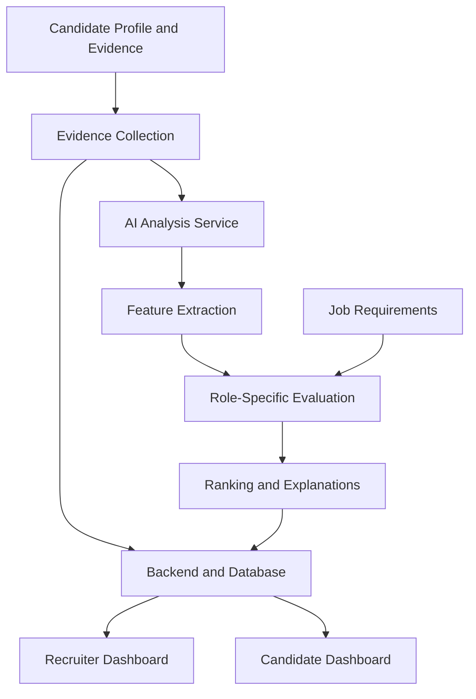

<h1 align="center">BeyondCV — Go Beyond the Resume</h1>

<p align="center">
  <strong>AI-powered technical talent evaluation, built around skills, evidence, and role fit.</strong>
</p>

<p align="center">
  <em>Move beyond resumes. Discover what candidates can actually do.</em>
</p>

<p align="center">
  
  
  
  
  
</p>

<p align="center">
  <a href="https://github.com/imkrishna07/BeyondCV-Model">AI Model</a> •
  <a href="https://github.com/imkrishna07/BeyondCV.Backend">Backend</a>
</p>

## What is BeyondCV?

Traditional hiring often starts with resumes, college names, job titles, and keywords. But a resume doesn't always reveal what someone can actually build, solve, or contribute.

**BeyondCV is an AI-powered technical talent evaluation platform designed to go beyond the traditional resume.**

It aims to analyze candidate evidence from multiple sources, extract relevant skills and accomplishments, and evaluate candidates against the requirements of a specific role.

Instead of relying on a resume alone, BeyondCV works toward a more evidence-driven view of technical talent.

### The idea

**Traditional hiring:** Resume → Shortlist → Interview

**BeyondCV:** Candidate Evidence → Skill Analysis → Role-Specific Evaluation → Explainable Ranking

The goal is not simply to generate another candidate score. It is to help recruiters understand **why a candidate may be suitable for a role, what evidence supports that assessment, and where skill gaps remain.**

---

## What BeyondCV aims to do

| Capability | Purpose |
|---|---|
| Resume Analysis | Extract relevant skills, experience and qualifications from resumes. |
| GitHub Analysis | Evaluate available development activity and repository evidence. |
| Competitive Programming | Incorporate coding-profile evidence where supported. |
| Project Analysis | Inspect supported project files and identify relevant technical evidence. |
| Skill Analysis | Connect available evidence to skills relevant to a role. |
| Role-Specific Ranking | Compare candidates against job requirements. |
| Explainable Evaluation | Present supporting evidence, skill gaps and data coverage alongside scores. |
| Candidate Profiles | Bring supported candidate information together in one place. |
| Recruiter Dashboard | Help recruiters review and compare candidates more efficiently. |

*Feature availability depends on the current implementation and the evidence sources successfully integrated into the ranking pipeline.*

---

## How it works



### 1. Collect candidate evidence

Candidates provide supported information and evidence, such as resumes, GitHub profiles, coding profiles and projects, subject to the platform's available integrations and consent controls.

### 2. Analyze the evidence

The AI service processes supported inputs through specialized analyzers to extract relevant technical information and structured features.

### 3. Match evidence to job requirements

The evaluation pipeline considers role requirements and available candidate evidence to calculate role-relevant scores.

### 4. Generate an explainable result

The intended output includes ranking information and useful context, such as supporting evidence, skill gaps and data coverage, so recruiters can interpret results rather than relying on an unexplained number.

### 5. Review candidates

The backend exposes application APIs that allow the frontend to present candidate information and ranking results to authorized recruiters.

---

## Architecture

BeyondCV is organized into separate services so that the user interface, application logic and AI analysis can evolve independently.

| Component | Technology | Responsibility |
|---|---|---|
| Frontend | React / TypeScript | Candidate and recruiter interfaces |
| Backend API | Django REST Framework | Authentication, profiles, jobs, permissions and application APIs |
| AI Service | Python / FastAPI | Evidence analysis, feature aggregation and role-specific ranking |
| Database | PostgreSQL | Structured application data and persisted records |
| Background Processing | Celery / Redis | Asynchronous evidence ingestion and processing |

### Repositories

- **AI Model:** [BeyondCV-Model](https://github.com/imkrishna07/BeyondCV-Model)
- **Backend:** [BeyondCV.Backend](https://github.com/imkrishna07/BeyondCV.Backend)

The repositories are separate parts of the broader BeyondCV project.

---

## Tech Stack

### Backend and AI

- Python
- Django REST Framework
- FastAPI
- PostgreSQL
- Celery
- Redis

### Frontend

- React
- TypeScript

### Engineering goals

- Modular service architecture
- Validated API contracts
- Asynchronous evidence processing
- Explainable, role-specific evaluation
- Testable scoring logic
- Privacy-aware handling of candidate data

---

## Getting Started

BeyondCV consists of multiple services. Each repository has its own dependencies and configuration.

### Prerequisites

- Git
- Python and pip
- Node.js and npm, for the frontend
- PostgreSQL
- Redis, for background processing where required

### 1. Clone the repositories

```bash
git clone https://github.com/imkrishna07/BeyondCV-Model.git
git clone https://github.com/imkrishna07/BeyondCV.Backend.git
```

Clone the frontend repository separately if it is maintained in a third repository.

### 2. Set up the AI service

```bash
cd BeyondCV-Model

python -m venv .venv
source .venv/bin/activate

pip install -r requirements.txt
```

Configure the environment variables required by the model service, following its repository documentation.

Start the service using the entry point and command documented in the model repository.

### 3. Set up the backend

```bash
cd BeyondCV.Backend

python -m venv .venv
source .venv/bin/activate

pip install -r requirements.txt
```

Configure the database, Django settings, authentication secrets, Redis/Celery settings and AI service URL according to the backend documentation.

Apply the database migrations and start the Django application using the documented development commands.

### 4. Set up the frontend

Clone the frontend repository, install its dependencies and configure its API base URL using that repository's instructions.

```bash
npm install
npm run dev
```

*These are starting-point commands, not a guarantee that all services will run without additional configuration. Follow each repository's README and environment example files for the exact setup.*

---

## Project Roadmap

BeyondCV is being developed incrementally, with the goal of connecting its existing services into a reliable end-to-end product.

- [ ] Complete the end-to-end candidate evidence and ranking workflow.
- [ ] Integrate supported evidence sources consistently across the backend and AI service.
- [ ] Improve ranking validation, explanations and data-coverage reporting.
- [ ] Complete candidate and recruiter dashboard integrations.
- [ ] Expand automated unit, API and end-to-end testing.
- [ ] Strengthen authentication, permissions, consent and data-retention controls.
- [ ] Validate deployment, monitoring, backups and recovery procedures.
- [ ] Evaluate scoring quality and potential bias before real-world hiring use.

---

## Responsible Evaluation

Candidate evaluation can affect people's opportunities. BeyondCV aims to support informed human review rather than replace it with an unexplained score.

Important principles include:

- **Evidence over assumptions:** Make the basis of an assessment understandable.
- **Missing data is not failure:** An unavailable profile or evidence source should not automatically be treated as a negative result.
- **Privacy and consent:** Collect and expose candidate information only for appropriate, authorized purposes.
- **Human oversight:** Treat automated rankings as decision-support signals, not definitive judgments of a person's ability.
- **Validation before deployment:** Assess scoring quality, reliability and fairness before using results in real hiring decisions.

---

## Contributing

Contributions, suggestions and bug reports are welcome.

1. Fork the relevant repository.
2. Create a branch for your changes.
3. Make your changes and add appropriate tests.
4. Submit a pull request describing the change and its motivation.

For changes involving scoring, evidence processing or ranking, include examples and tests that help reviewers understand the expected behavior.

---

## License

The license for each repository should be checked before redistributing or combining its code. Add the applicable project-level license here once the licensing of all components has been confirmed.

---

<p align="center">
  <strong>BeyondCV — Look beyond the resume. Evaluate the evidence.</strong>
</p>
